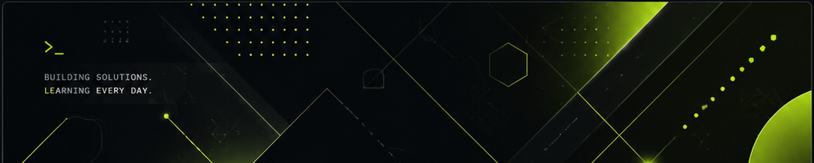

# EPHRAIM TESSEMA

**Computer Science & Engineering Student · Developer · Builder · Problem Solver**

*I enjoy turning ideas into useful software and learning by building.*

---

<table>
<tr>
<td width="50%" valign="top">

## About me

I'm a Computer Science and Engineering student interested in software development, thoughtful UI/UX, and building products that solve real problems.

I work across web and mobile development, and I'm always looking for opportunities to learn, build, and collaborate.

### Currently learning

- Advanced React and state management
- Backend development with Node.js
- System design and software engineering best practices

### Interests

- Web development
- Mobile app development
- UI/UX design
- Problem solving
- Building practical products

</td>
<td width="50%" valign="top">

## Tech stack

**Languages**

**Web & mobile**

**Backend & tools**

</td>
</tr>
</table>

## Featured projects

<table>
<tr>
<td width="50%" valign="top">

### [ASTU Lost & Found](https://github.com/ephraintessema-lgtm/astu_lost_and_found)

A platform for ASTU students to report, discover, and claim lost items around campus.

`JavaScript` `React` `MongoDB`

</td>
<td width="50%" valign="top">

### [Mama-Care](https://github.com/ephraintessema-lgtm/Mama-Care)

A pregnancy-support web app designed to make helpful information and support more accessible to mothers.

`React` `Vite` `Supabase`

</td>
</tr>
<tr>
<td width="50%" valign="top">

### [CS-Toolkit Pro](https://github.com/ephraintessema-lgtm/CS-Toolkit_pro)

A collection of useful tools and utilities for computer science students and developers.

`JavaScript`

</td>
<td width="50%" valign="top">

### [BethVerse](https://github.com/ephraintessema-lgtm/bethverse)

A private, offline poetry vault for writing, storing, and keeping personal poems.

`React Native` `Expo` `JavaScript`

</td>
</tr>
</table>

## GitHub activity

---

**BUILDING SOLUTIONS. LEARNING EVERY DAY.**

*The best way to predict the future is to build it.*

